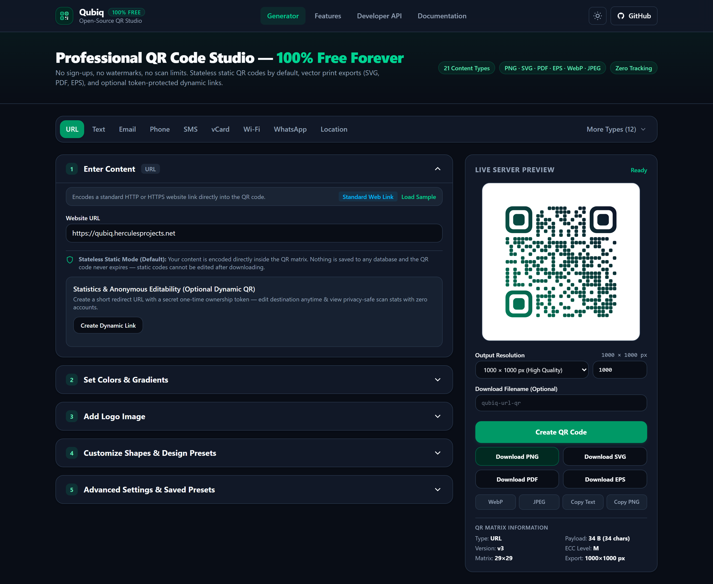

# Qubiq — Free Open-Source QR Code Studio & Developer API

[](https://qubiq.herculesprojects.net)
[](https://github.com/MrSwagger1337/Qubiq/actions/workflows/tests.yml)
[](#requirements)
[](#quick-start)
[](LICENSE)

**Qubiq** ([qubiq.herculesprojects.net](https://qubiq.herculesprojects.net)) is a complete, production-ready, privacy-first **PHP QR Code Generator web application and REST API**. Generate high-resolution custom vector and raster QR codes **100% free** — with zero accounts, zero watermarks, zero ads, zero scan limits, and zero tracking.



---

## Highlights & Features

- **100% Free & Privacy-First**: Stateless static QR generation stores **zero** user payloads in any database or log file.
- **Shared-Hosting Friendly (PHP 8.2+ & Zero Node.js)**: Runs out-of-the-box on cPanel, DirectAdmin, Plesk, LiteSpeed, Apache, Nginx, and Docker. Pre-compiled CSS (`public/assets/css/app.css`) and modular Vanilla ES JavaScript (`public/assets/js/*.js`) ship directly in the repository — **no Node.js build step required on your server**.
- **21 Built-in QR Content Encoders**:
  - **Core**: Website URL (IDN-aware), Plain Text (UTF-8 & Emoji), Email (`mailto:`), Phone (`tel:`), SMS (`SMSTO:`), vCard 3.0, MeCard, Geographic Location (`geo:`), Wi-Fi (`WIFI:`), Calendar Event (iCalendar `VEVENT`), Bitcoin (`BIP21`), Custom Safe URI.
  - **Social, Messaging & Commerce**: WhatsApp, Telegram, Facebook, X / Twitter, YouTube, Instagram, LinkedIn, PayPal, App Store / Play Store / Deep Links.
- **Studio-Grade Customization & Scannability**:
  - **Colors & Gradients**: Solid, linear gradient (`0°–360°`), and radial gradient foregrounds; solid, transparent, or gradient backgrounds; independent outer & inner corner finder ("eye") colors; WCAG luminance contrast checker and scannability advisor.
  - **Custom Geometry**: 6 module shapes (`square`, `rounded`, `circle`, `dots`, `diamond`, `soft`), 4 outer finder frames (`square`, `rounded`, `circle`, `cushion`), and 3 inner finder centers (`square`, `rounded`, `circle`).
  - **Hardened Logo Embedding**: Server-validated `PNG`, `JPEG`, and `WebP` logo uploads (magic-byte verified via `finfo`, pixel-count bounded, stripped of metadata via GD RGBA re-encoding), auto-recommended ECC `H`, adjustable logo scale, quiet-zone padding, and rounded/square backing plate.
  - **Advanced Controls**: Error correction (`L`, `M`, `Q`, `H`), QR versions (`auto` or `1–40`), mask patterns (`auto` or `0–7`), quiet zone (`0–10` modules), 7 curated presets, browser-saved custom presets, and JSON configuration import/export.
- **6 Authentic Export Formats (`128 px` – `2048 px`)**:
  - **Vector Print Formats**: Native `SVG`, vector `PDF` (custom FPDF vector path primitives), and Encapsulated PostScript `EPS` (`EPSF-3.0`).
  - **Raster Formats**: Anti-aliased `PNG` (alpha support), `WebP` (alpha support), and `JPEG`.
- **Optional Anonymous Dynamic QR Codes**:
  - Editable destination URLs (`/r/{code}`) protected by a one-time **256-bit ownership token** (only its `SHA-256` hash is stored in SQLite).
  - Privacy-respecting aggregate daily scan counters and coarse device rollups — **never storing raw visitor IP addresses or tracking cookies**.
- **Public Developer REST API v1 & OpenAPI 3.1**:
  - Endpoints for validation, preview, JSON/binary export, and token-authenticated dynamic link management (`/api/v1/*` + `/openapi.json`).

---

## Technology Stack

| Layer | Stack |
| --- | --- |
| **Backend** | PHP `8.2` / `8.3` / `8.4+` (`declare(strict_types=1)`, PSR-4, PSR-12), `chillerlan/php-qrcode` `^6.0`, `setasign/fpdf` `^1.8`, `vlucas/phpdotenv` `^5.6` |
| **Persistence** | Optional PDO SQLite (`WAL` mode) for Dynamic QR links only; Static QR pipeline is 100% stateless |
| **Frontend** | Semantic HTML5 (WCAG 2.2 AA target), pre-built Tailwind CSS v4, Vanilla ES Modules, Light/Dark themes |
| **Quality & Security** | PHPUnit 11 (including real ZXing QR decoder tests), PHPStan Level 8 (`0` errors), Laravel Pint (PSR-12), strict CSP (`script-src 'self'`) |

---

## Requirements

- **PHP `8.2+`** (`8.2`, `8.3`, or `8.4+`)
- **Required Extensions**: `ext-fileinfo`, `ext-gd`, `ext-json`, `ext-mbstring`, `ext-pdo`
- **Optional Extensions**: `ext-pdo_sqlite` (only when `DYNAMIC_QR_ENABLED=true`), `ext-intl` (IDN punycode domain normalization)
- **Node.js**: **Not required** to deploy or run Qubiq (optional `Node 20+` only when modifying `resources/css/` or `resources/js/`)

---

## Quick Start

### 1. Shared Hosting (cPanel / DirectAdmin / Plesk — No Node.js Needed)

1. Run `composer install --no-dev --optimize-autoloader` locally (or use a pre-packaged release archive) and copy `.env.example` to `.env`.
2. **Recommended**: Upload project to `/home/<user>/qubiq` and point your domain's Document Root to `/home/<user>/qubiq/public`.
3. **Locked `public_html/` or Subfolder**: Upload directly into `public_html/` (or `public_html/qr/`). Root `.htaccess` + directory `.htaccess` guards automatically protect `.env`, `storage/`, `vendor/`, and internal folders while routing requests cleanly.
4. Ensure `storage/` is writable (`chmod -R 775 storage`).

See [docs/INSTALLATION.md](docs/INSTALLATION.md) and [docs/DEPLOYMENT.md](docs/DEPLOYMENT.md) for complete shared-hosting and Nginx/PHP-FPM instructions.

### 2. Local PHP Development Server

```bash
git clone https://github.com/MrSwagger1337/Qubiq.git
cd Qubiq
composer install
cp .env.example .env
php database/migrate.php
composer serve
```

Visit `http://localhost:8000`.

### 3. Docker Compose

```bash
cp .env.example .env
docker compose up -d --build
```

Visit `http://localhost:8080`.

---

## Environment Configuration (`.env`)

| Variable | Default | Purpose |
| --- | --- | --- |
| `APP_ENV` / `APP_DEBUG` | `production` / `false` | Environment mode; never enable `APP_DEBUG=true` in production |
| `APP_URL` | `https://qubiq.herculesprojects.net` | Canonical base URL for generated short links and docs |
| `APP_KEY` | *(auto-derived in dev)* | Secret HMAC key for privacy-preserving rate-limit IP hashing |
| `QR_MIN_SIZE` / `QR_MAX_SIZE` | `128` / `2048` | Allowed pixel dimensions for exports |
| `LOGO_MAX_BYTES` | `2097152` (`2 MB`) | Strict upload byte ceiling for PNG/JPEG/WebP logos |
| `DYNAMIC_QR_ENABLED` | `true` | Toggle anonymous editable `/r/{code}` links & SQLite persistence |
| `DYNAMIC_QR_SAFE_INTERSTITIAL` | `false` | Show destination preview screen before redirecting dynamic links |
| `RATE_LIMIT_ENABLED` | `true` | Enable per-bucket HMAC rate limiting (`preview`, `export`, `api`, `dynamic_create`) |

---

## Developer API Quick Example

Generate a high-resolution vector PDF QR code directly from the command line:

```bash
curl -X POST http://localhost:8000/api/v1/qr/export \
  -H "Content-Type: application/json" \
  -d '{
    "type": "url",
    "fields": { "url": "https://qubiq.herculesprojects.net" },
    "format": "pdf",
    "design": {
      "size": 1200,
      "ecc": "H",
      "moduleShape": "rounded",
      "finderOuterShape": "rounded",
      "colorMode": "linear",
      "foregroundColor": "#0f172a",
      "gradientEndColor": "#047857"
    }
  }' \
  --output qubiq-vector.pdf
```

Full API documentation is available in [docs/API.md](docs/API.md), interactively at `/api-docs`, and as an OpenAPI 3.1 schema at `/openapi.json`.

---

## Quality Assurance & Automated Tests

```bash
# Run PSR-12 style check, PHPStan Level 8 static analysis, and PHPUnit suite
composer check

# Individual checks
composer lint      # Laravel Pint PSR-12 verification
composer stan      # PHPStan Level 8 analysis
composer test      # PHPUnit (Unit, Feature, Integration & real ZXing QR decode tests)
npm run check      # Optional JS ES-module syntax & asset existence verification
```

---

## Security, Privacy & Known Technical Limitations

- **SVG Logos Intentionally Unsupported**: To eliminate embedded XML/XSS/XXE attack vectors and maintain 100% MIT license compatibility across SVG, GD, PDF, and EPS renderers, logo uploads accept strictly verified binary `PNG`, `JPEG`, and `WebP` images (`<= 2 MB`, `<= 2048x2048 px`).
- **Format Transparency Differences**: `SVG`, `PNG`, and `WebP` preserve alpha transparency when "Transparent Background" is enabled; `JPEG`, `PDF`, and `EPS` composite onto a solid white surface (and report this transparently in `renderer_notes`).
- **Wi-Fi QR Compatibility**: Consumer smartphone camera scanners support `WPA`/`WPA2`/`WPA3-Personal` (`T:WPA`), `WEP`, and open networks (`nopass`). Enterprise `802.1X` (`EAP`) profiles are not uniformly supported by native OS camera scanners.
- **Dynamic QR Host Dependency**: Static QR codes work forever offline without any server. Optional Dynamic QR codes (`/r/{code}`) encode a redirect URL on your Qubiq instance and therefore depend on your domain remaining online, plus keeping your one-time ownership token safe.

For full threat-modeling details, see [docs/SECURITY.md](docs/SECURITY.md) and [SECURITY.md](SECURITY.md).

---

## Documentation Index

- [Installation Guide](docs/INSTALLATION.md)
- [Architecture Overview](docs/ARCHITECTURE.md)
- [REST API v1 Reference](docs/API.md)
- [Production Deployment Guide](docs/DEPLOYMENT.md)
- [Security & Privacy Architecture](docs/SECURITY.md)
- [Contributing Guidelines](CONTRIBUTING.md) · [Code of Conduct](CODE_OF_CONDUCT.md) · [Changelog](CHANGELOG.md) · [Third-Party Notices](NOTICE.md)

---

## Roadmap

- Optional localized UI language packs (`ar`, `de`, `es`, `fr`, `ja`) via `resources/lang/`
- Batch CSV -> ZIP static QR CLI exporter for print shops
- Optional Redis rate-limit adapter for multi-node horizontal deployments

---

## License

Released under the [MIT License](LICENSE). Third-party package attributions are documented in [NOTICE.md](NOTICE.md).
