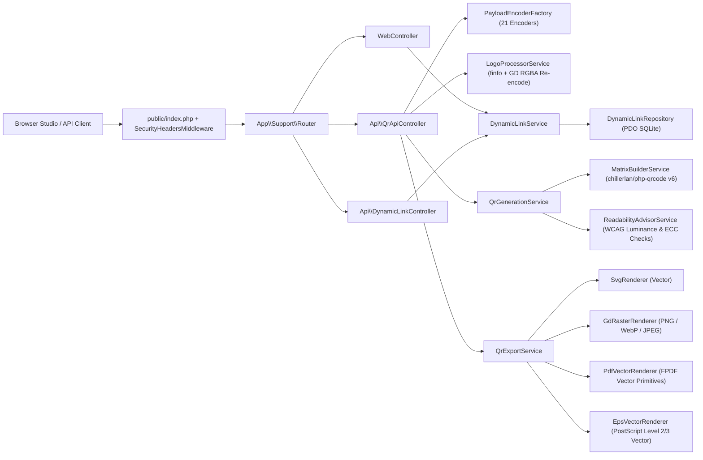

# System Architecture

Qubiq uses a lightweight, zero-bloat, strict-typed MVC/service architecture built on **PHP 8.2+** and PSR-4 autoloading (`App\`). Static QR generation is **100% stateless** (touching zero database tables), while optional anonymous dynamic QR links use a compact SQLite schema outside the public web root.

---

## Directory Responsibilities

| Path | Responsibility |
| --- | --- |
| `app/Controllers/` | Thin HTTP & REST API controllers delegating business logic to services |
| `app/Exceptions/` | Domain exceptions (`ValidationException`, `CapacityOverflowException`, `RateLimitException`, etc.) mapped cleanly to HTTP status codes |
| `app/Middleware/` | `SecurityHeadersMiddleware` (CSP, `X-Frame-Options`, `nosniff`, CORS) and HMAC-IP file-backed `RateLimiter` |
| `app/Payloads/` | `PayloadEncoderInterface`, `PayloadEncoderFactory`, and 21 isolated content encoders (`UrlPayload` through `CustomUriPayload`) |
| `app/Repositories/` | `DynamicLinkRepository` — PDO prepared statements only, zero raw SQL interpolation |
| `app/Services/Dynamic/` | `DynamicLinkService` — CSPRNG short-code & 256-bit ownership token generation, SHA-256 verification, bot-filtered daily rollup counters |
| `app/Services/Export/` | `QrExportService` — orchestrates format selection (`png`, `svg`, `pdf`, `eps`, `webp`, `jpeg`) and renderer capability notes |
| `app/Services/QR/` | `QrDesignOptions`, `MatrixBuilderService`, `LogoProcessorService`, `ReadabilityAdvisorService`, `QrGenerationService` |
| `app/Services/Rendering/` | Dedicated native renderers (`SvgRenderer`, `GdRasterRenderer`, `PdfVectorRenderer`, `EpsVectorRenderer`) |
| `app/Support/` | Framework-agnostic primitives (`Config`, `Env`, `HttpRequest`, `HttpResponse`, `Router`, `View`, `Color`, `Logger`, `Translator`, `OpenApiSpecBuilder`) |
| `app/Validators/` | `UrlSafetyValidator` — scheme allowlists, IDN normalization, control-byte & dangerous URI rejection |
| `public/` | Web document root (`index.php`, `.htaccess`, pre-compiled `assets/css/` & `assets/js/`) |
| `resources/` | Server-rendered accessible templates (`views/`), i18n strings (`lang/en.php`), and source CSS/JS |
| `storage/` | Non-public runtime storage (`database/`, `logs/`, `cache/ratelimit/`, `tmp/`) protected by `.htaccess` |
| `tests/` | Unit, Feature, and Integration suites (including real ZXing QR matrix decoding assertions) |

---

## Key Architectural Decisions

### 1. Stateless Static Pipeline vs. Optional SQLite Dynamic Pipeline
- Static QR previews and exports (`POST /api/v1/qr/*`) execute purely in memory and never open a SQLite connection. Even if `pdo_sqlite` is disabled on a minimal host, setting `DYNAMIC_QR_ENABLED=false` allows the entire static QR studio and export API to operate at full capacity.

### 2. Capability-Aware Multi-Format Rendering
Rather than rasterizing everything to PNG and wrapping bitmaps inside fake vector containers, Qubiq implements **four genuine rendering engines**:
- **SVG (`SvgRenderer`)**: True `<svg>` DOM with `<linearGradient>` / `<radialGradient>`, custom finder `<path>` geometry, body shapes (`square`, `rounded`, `circle`, `dots`, `diamond`, `soft`), and sanitized PNG data-URI logo embedding.
- **Raster (`GdRasterRenderer`)**: Supersampled anti-aliased GD rendering with per-pixel linear/radial gradient interpolation, alpha transparency (`PNG` & `WebP`), and automatic opaque background compositing for `JPEG`.
- **PDF (`PdfVectorRenderer` + `QubiqPdfDocument`)**: Native PDF vector drawing commands (`m`, `l`, `c`, `h`, `f`, `f*`) via an extended FPDF engine for crisp infinite-zoom print output, interpolating module colors smoothly across gradients.
- **EPS (`EpsVectorRenderer`)**: Standards-compliant Encapsulated PostScript (`%!PS-Adobe-3.0 EPSF-3.0`) with `%%BoundingBox`, vector paths for all module & finder shapes, and ASCII85/hex `colorimage` embedding when a logo is present.

### 3. Shared-Hosting & Zero-Node Compatibility
- Locked to PHP `8.2.28` platform target in `composer.json` so dependencies resolve cleanly on PHP `8.2`, `8.3`, and `8.4+`.
- Frontend uses Vanilla ES Modules (`public/assets/js/*.js`) with zero bundler runtime overhead and pre-built Tailwind CSS (`public/assets/css/app.css`), eliminating Node.js from production servers.

